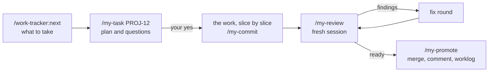
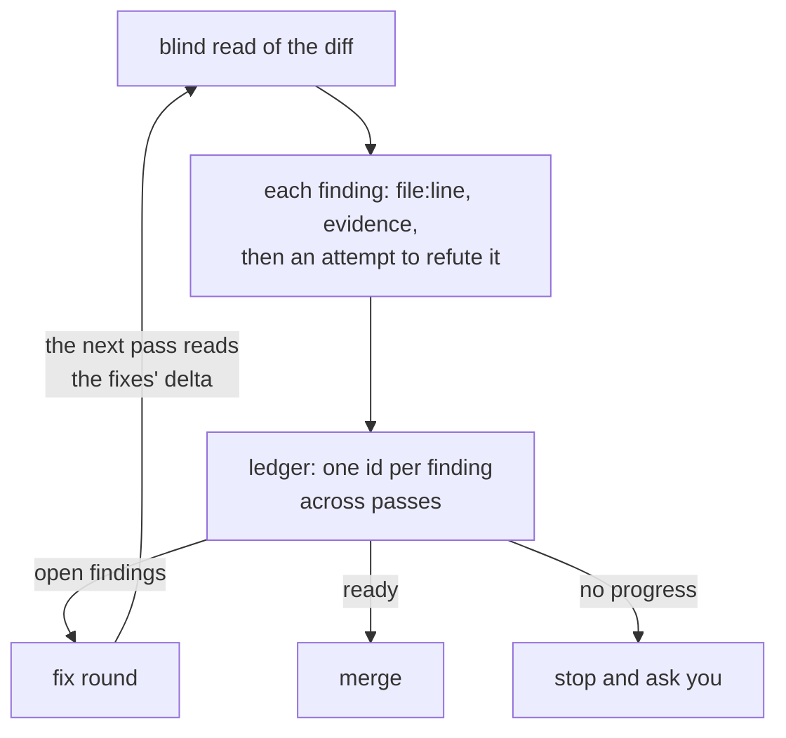

# work-agent-tools

Claude Code plugins that take a team's task from the board to the merge as a
chain of commands written for the project — each ending with the next one,
ready to paste.

- **The next prompt, ready.** Every workflow command ends with the next step
  as a block to copy, and says whether it belongs in a fresh session.
- **Sources, not memory.** The agent works from the issue, the spec, the
  design and the code; what they leave open becomes a question to you.
- **Reviews that prove their findings and know when to stop.** They check the
  code against the design, not only itself; zero findings is a valid result.
- **The tracker kept on the way.** The next issue to take is the one nothing
  blocks, ranked by what it unblocks; issues to one standard, statuses, the
  result comment and the worklog are steps of the chain, not afterthoughts.
- **The method reaches every project.** The workflow commands are the
  project's own, shaped to its branches, forge and tracker; a change of the
  method arrives as an edit `audit` proposes.

For a team on a tracker — Jira recommended — and GitHub or GitLab, including
self-hosted. A solo GitHub project without a tracker fits
[agent-tools](https://github.com/maximlukyanovich/agent-tools).

## How a task runs



`setup` writes the `my-` commands into the project — the prefix is the
project's own, so none hides a built-in command — and the plugins supply the
shared half. Each arrow is a block the agent prints at the end of a command,
pointing at the plan, the branch and the review ledger instead of retelling
them, so the next session reads the sources again rather than a summary of
the last one. A small change — by its size and risk — runs whole in one
session.

A task starts by reading before it plans: the issue, the code, the project
profile, the spec and the design, the library's documentation instead of the
model's memory of it. What these do not answer is asked — in the chat or as
questions on the issue — and no code is written before you approve the plan.

## Why the review is different



- **A serious finding is proved.** A `blocker` or `major` names the line and the
  scenario, and the reviewer tries to refute it in the code before reporting.
- **A finding keeps its id.** A recorded false positive is not raised again
  without a new mechanism; an incomplete fix stays the same finding.
- **The design is measured, not eyeballed.** In a project built against a
  design, the review's `layout` mode compares the app's computed styles with
  the design's screen, and a value off the design's scale is a finding.
- **Repeat passes read what changed** — the fixes and what they removed —
  instead of the whole branch again.
- **It converges.** `minor` and `nit` get a decision, not another pass; a pass
  that makes no progress stops and asks.

The built-in `/code-review` of Claude Code 2.1.319 asks for a minimum number
of findings and does not verify its candidates. A review here is a check, not
a quota: zero findings is a valid result.

## Measured

On live projects, against the built-in `/code-review` at `high` — 14 branches,
about 40 passes, 2026-11-08:

- **Full pass.** On one project's 8 branches the built-in review found no
  `major` that ours missed, and ours found 7 that it missed; on the other's 6,
  3 to 3.
- **False findings.** One in about 40 passes, dropped before the report;
  the built-in raised 9 on one project and one or two per pass on half of
  the other's.
- **Price.** A full pass costs about three built-in runs and finds as many
  more confirmed findings: per confirmed finding the two are about even.
- **Sessions.** On a team project, 84 % of 320 sessions over 40 merged tasks
  started with a command or a block the agent had printed.

Conditions, the repeat passes on fixes and the cost of a fix round in an old
session: [`docs/measured.md`](docs/measured.md).

## Plugins

Each plugin is enabled on its own, so a project takes only what fits.

| Plugin | For | What it does |
| --- | --- | --- |
| [`work-bootstrap`](plugins/work-bootstrap/README.md) | any repository, any stack | Creates a project or writes its harness — `AGENTS.md`, the profile, the workflow commands, hooks — and audits it against the method; a session-start hook says when it falls behind. |
| [`work-tracker`](plugins/work-tracker/README.md) | issues in a tracker | `plan`, `create`, `questions`, `status`, `comment`, `next`: hierarchy, description shape, statuses, worklog. Jira Cloud ships as the adapter; another tracker gets one by the plugin's contract. |
| [`work-estimation`](plugins/work-estimation/README.md) | estimated before it starts | An estimate from a spec and a design handoff, every figure traced to its source: a markdown report and the estimate workbook. |

## Quick start

You need Claude Code — 2.1.292 or later for the one-line start in an empty
folder — `git`, `gh` or `glab` signed in, and `python3` for the
scripts and the session-start hook. Per-plugin needs — a Jira `.mcp.json`, the
estimate workbook — are in each plugin's README.

Once per machine — it adds the source and loads nothing into sessions:

```bash
claude plugin marketplace add maximlukyanovich/work-agent-tools
```

Skip it on a machine that works in a project pinned to a release: see
[Pinning a release](docs/updates.md#pinning-a-release).

In an existing repository:

```bash
claude plugin install work-bootstrap@mluk-work-agent-tools --scope project
claude "/work-bootstrap:setup"
```

`setup` looks at the code, asks only what it cannot answer — the other plugins
included — shows a plan and, on your yes, writes the harness — `AGENTS.md`,
the project profile, the workflow commands — and records the plugins in
`.claude/settings.json`, which is committed, so the team runs the same tooling.
In an empty folder, `/work-bootstrap:new` creates the project first:

```bash
mkdir my-app && cd my-app
claude plugin install work-bootstrap --marketplace maximlukyanovich/work-agent-tools --scope project && claude "/work-bootstrap:new"
```

Every plugin introduces itself, read-only: `/work-bootstrap:help`,
`/work-tracker:help`, `/work-estimation:help ru`.

A project that `setup` wrote receives new versions by itself. Elsewhere, turn
that on once: `/plugin` → **Marketplaces** → `mluk-work-agent-tools` →
**Enable auto-update**. Scopes, updates, releases and pinning a project to one:
[`docs/updates.md`](docs/updates.md).

## How it's built

`work-bootstrap` generates: what `setup` writes becomes the project's own code,
and a method change reaches it as an entry in
[`CHANGES.md`](plugins/work-bootstrap/CHANGES.md) that `audit` applies.
`work-tracker` and `work-estimation` are libraries: the procedure stays here,
and the project contributes a profile, `.claude/project-profile.md`, that every
command reads first — [`docs/design.md`](docs/design.md).

Issues and pull requests are welcome — [`CONTRIBUTING.md`](CONTRIBUTING.md).
[MIT](LICENSE).
